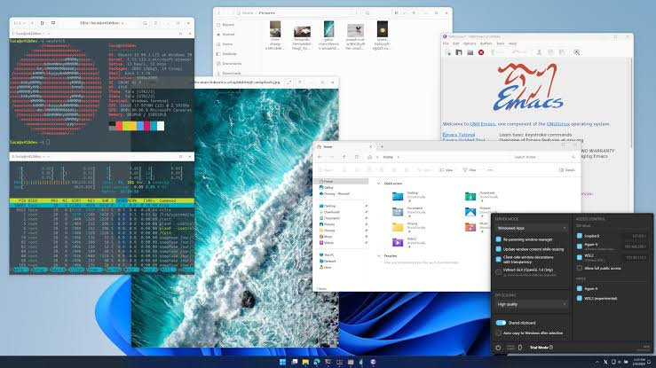
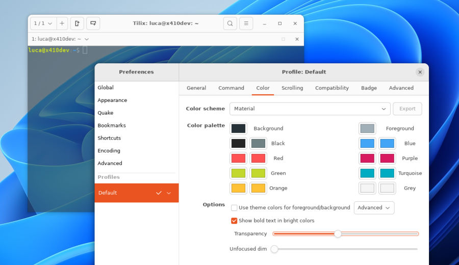

# X410 for Linux Windows and Desktop Sessions

Choose where the application runs, how its display reaches Windows, and whether you want individual windows or a complete desktop.
X410 is the Windows X server that receives the graphical output; the Linux application continues running in its own environment.

## Choose the shape of the workspace

Use Windowed Apps mode for individual Linux applications alongside Windows applications.
Use X410 Desktop mode when a Linux desktop environment should occupy a single desktop window.
A desktop session also needs the appropriate Linux desktop packages and session command.

The following PowerShell example starts a separate X410 display in Windowed Apps mode with loopback access:

```powershell
x410.exe :1 /wm /loopback
```

The [command-line reference](https://x410.dev/cookbook/command-line-switches/) documents display numbers, modes, and listeners.
The Microsoft Store version provides an execution alias; the standalone version may require its executable path.
Changing mode on an already running display restarts that X410 instance, so finish work in connected applications first.

For a comparison of presentation modes, WSLg's [wslg.rdp](package/wslg.rdp) enables remote-application mode.
Its [wslg_desktop.rdp](package/wslg_desktop.rdp) omits that remote-application setting.

[](https://x410-desktop.github.io/X410-WSL/)

## Match DISPLAY to the connection path

An X410 WSL session needs a route from the Linux X11 client to the selected X410 display.
The address depends on WSL networking and the transport you chose.

| Connection path | Address from Linux | Additional component | Main condition |
| --- | --- | --- | --- |
| WSL2 with NAT over TCP | Reachable Windows host address | None for ordinary X11 TCP | Allow the WSL2 connection in X410 |
| WSL2 with mirrored networking over TCP | Windows loopback address | None for ordinary X11 TCP | Mirrored networking is already enabled |
| WSL2 over VSOCK | Relay endpoint or supported patched-library syntax | Relay or modified client library | Enable X410's WSL2 VSOCK listener |

Microsoft's [WSL networking guide](https://learn.microsoft.com/en-us/windows/wsl/networking) explains the NAT and mirrored distinction.
The [X410 WSL2 guide](https://x410.dev/cookbook/wsl/using-x410-with-wsl2/) describes its TCP and VSOCK paths.

### A mirrored-networking example

On a supported Windows 11 system, the following user-level .wslconfig setting selects mirrored networking.
Apply it only as part of a deliberate WSL configuration change; restarting WSL affects running Linux sessions.

```ini
[wsl2]
networkingMode=mirrored
```

With mirrored networking active and the display-1 X410 instance above running, a Bash session can launch an installed X11 terminal:

```bash
export DISPLAY=127.0.0.1:1.0
xterm
```

The display number must match the X410 instance.
For NAT networking, use the reachable Windows host address and the matching X410 access-control setting instead.

### Keep the WSLg route identifiable

WSLg normally supplies its own display environment.
Set the X410 destination for the intended application session rather than assuming every Linux GUI application should change display servers.

The WSLg system-distro [wsl.conf](config/wsl.conf) starts WSLGd, while [weston.ini](config/weston.ini) configures its compositor environment.
[xwayland_log.patch](config/xwayland_log.patch) adds XWayland logging to that reference setup.



## Forward a remote application through SSH

For a remote Linux host, use an SSH client with X11 forwarding and a server configured to permit it.
X410's [Windows SSH guide](https://x410.dev/cookbook/built-in-ssh-x11-forwarding-in-powershell-or-windows-command-prompt/) specifies trusted forwarding with the -Y option.

For the same display-1 instance, run this in Windows PowerShell with a trusted host and your own account:

```powershell
$env:DISPLAY = "127.0.0.1:1.0"
ssh -Y your_user@your_server
```

Trusted forwarding gives remote X11 applications access to the local display session.
After login, launch the installed graphical application from the remote shell.
Let the SSH server assign the remote DISPLAY value; overwriting it with the Windows address bypasses the intended forwarding route.

The Windows-side DISPLAY and remote-side DISPLAY serve different parts of the connection.
Keep that distinction when switching between local WSL applications and applications running on another computer.

## Distinguish a visible window from application integration

An X410 X server session can show an application even when no Windows shortcut has been created for it.
Treat launching, window presentation, and application discovery as separate parts of the workflow.

WSLg's application-list channel provides a useful implementation comparison:

- [rdpapplist_protocol.h](rdpapplist/rdpapplist_protocol.h) defines channel commands and protocol version information.
- [rdpapplist_common.h](rdpapplist/rdpapplist_common.h) and [rdpapplist_common.c](rdpapplist/rdpapplist_common.c) declare and implement common header serialization.
- [rdpapplist_server.h](rdpapplist/rdpapplist_server.h) defines server callbacks for application-list operations.
- [rdpapplist_main.h](rdpapplist/server/rdpapplist_main.h) holds private channel state; [rdpapplist_main.c](rdpapplist/server/rdpapplist_main.c) implements the server channel.
- The server [meson.build](rdpapplist/server/meson.build) links the channel library, while the parent [meson.build](rdpapplist/meson.build) configures the project and dependencies.

These components illustrate how an integration layer can carry application information separately from graphical output.



## Adjust readability and sharing independently

For X410 windowed apps, compare application-level scaling with X410's built-in DPI scaling.
The [HiDPI guide](https://x410.dev/cookbook/running-x410-on-hidpi-screens/) explains the difference between rendering larger in the application and scaling its completed output.
Check menu text, fine lines, and pointer interaction after changing the scale.

Enable X410 clipboard sharing when the workflow needs copying between Windows and Linux.
Test the actual content type used by the application, such as plain text or an image.

WSLg's [local.conf](config/local.conf) exposes font directories through fontconfig.
Its [default_wslg.pa](config/default_wslg.pa) loads a Windows sound sample for the X11 bell.
These files illustrate that font discovery and audio behavior have their own configuration paths.

An X410 floating desktop should also be checked at the window size used for everyday work.
Make sure the desktop panel and application controls remain reachable after resizing.

## Carry the connection into containerized applications

A container has its own view of environment variables and filesystem mounts.
A working graphical application in the WSL shell does not automatically establish a working display connection inside a container.

The WSLg [Containers.md](samples/container/Containers.md) sample explains which display and audio resources it shares.
[run.sh](samples/container/run.sh) passes the corresponding mounts and environment variables.
[build.sh](samples/container/build.sh) refers to example container build recipes.

For an X410 container workflow, identify the actual X410 transport before adapting any launcher.
Keep Wayland, X11, audio, and GPU requirements separate when deciding what the container needs.
The WSLg [weston.list](debuginfo/weston.list) and [rdpapplist.list](debuginfo/rdpapplist.list) enumerate compositor and application-channel files used by its debug-information tooling.

## Related Search Terms

X410 Desktop, X410 WSL, x410 x server, x410 floating desktop, x410 windowed apps, x11, x-server, wsl, wsl2, windows, linux, ssh, remote-app, remote-desktop, hidpi
